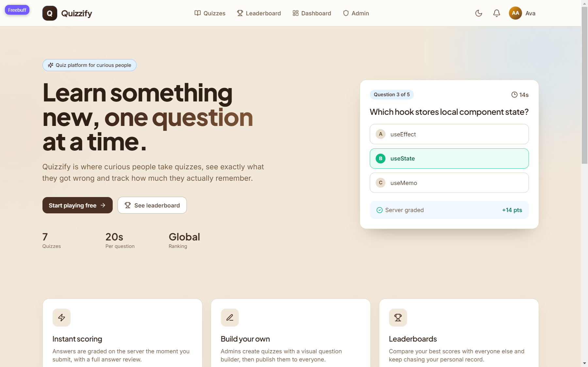
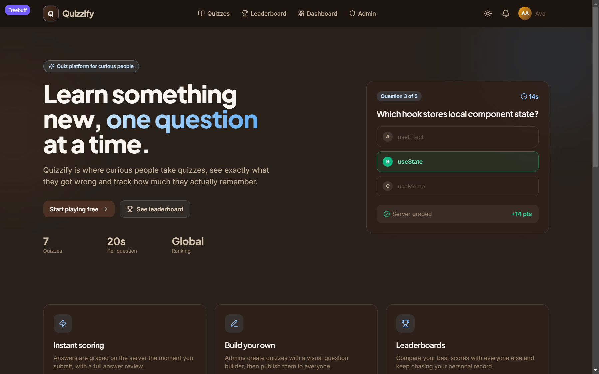
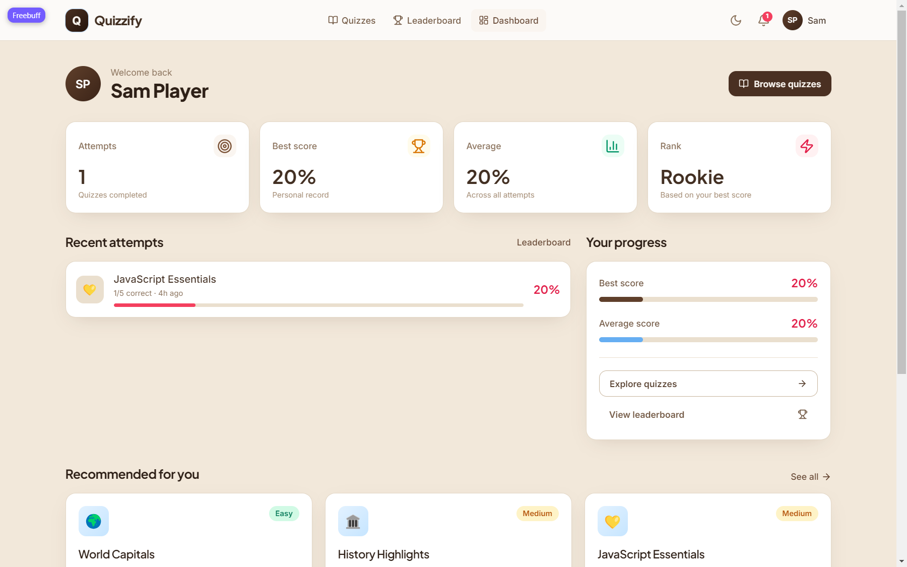
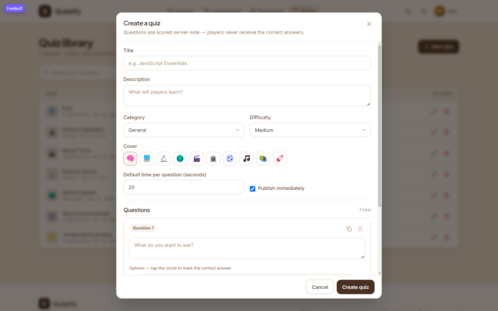

# Quizzify — full-stack online quiz platform

Quizzify is a MERN application for creating, playing and hosting quizzes in real time. Players browse a
catalogue of quizzes, get server-graded scores with answer reviews, climb leaderboards and receive instant
in-app notifications over WebSockets.

Built to satisfy the Full-Stack Project Checklist: responsive React + Tailwind UI, Context API state
management, secure Express REST API, MongoDB/Mongoose models, JWT auth with role-based access control,
Socket.IO real-time features, Docker, GitHub Actions CI and documentation.

---

## Table of contents

1. [Feature highlights](#feature-highlights)
2. [Tech stack](#tech-stack)
3. [Architecture](#architecture)
4. [Getting started](#getting-started)
5. [Environment variables](#environment-variables)
6. [Demo accounts](#demo-accounts)
7. [Scripts](#scripts)
8. [API documentation](#api-documentation)
9. [Real-time notifications](#real-time-notifications)
10. [Testing](#testing)
11. [Docker](#docker)
12. [Deployment](#deployment)
13. [Database schema](#database-schema)
14. [Security notes](#security-notes)
15. [Project status & limitations](#project-status--limitations)

---

## Screenshots

| Landing (light) | Landing (dark) |
| --- | --- |
|  |  |

| Dashboard | Quiz library |
| --- | --- |
|  |  |

More captures (quiz player, leaderboard, admin overview, mobile) live in [`screenshots/`](screenshots).

---

## Feature highlights

**Players**

- Browse/search/filter quizzes by category, difficulty and popularity with pagination.
- Timed quiz player: per-question countdown, progress bar, auto-advance, full answer review with explanations.
- Personal dashboard: attempts, best score, average score, recent history and recommended quizzes.
- Global and per-quiz leaderboards.
- In-app notifications pushed over WebSockets when an attempt scores well.

**Admins**

- Create, edit, publish/unpublish and delete quizzes with a full question builder.
- Platform analytics: users, quizzes, attempts, average score, top quizzes, recent activity.
- User management with role changes (`user` ↔ `admin`), protected against self-demotion.

**Interface**

- Fully responsive layouts for mobile, tablet and desktop with a collapsible navigation menu.
- Light/dark mode with a persisted preference.
- Reusable Tailwind component classes (`.btn`, `.card`, `.input`, `.chip`), hover/focus transitions.
- Client-side form validation, inline API errors, toast notifications, modals, loading skeletons.

---

## Tech stack

| Layer            | Technology                                                                 |
| ---------------- | -------------------------------------------------------------------------- |
| Frontend         | React 18, Vite 5, React Router 6, Tailwind CSS 3, Lucide icons, Axios       |
| State            | React Context API (Auth, Theme, Toast, Socket, Notifications) + custom hooks |
| Backend          | Node.js, Express 4, Socket.IO 4                                             |
| Database         | MongoDB 7 with Mongoose 8 (schemas, validation, indexes, populate)          |
| Auth             | JWT bearer tokens, bcrypt password hashing, token revocation on logout      |
| Validation       | Zod schemas on every write endpoint                                         |
| Testing          | Node.js built-in test runner + Supertest (23 API integration tests)          |
| Containerisation | Docker multi-stage images + Docker Compose (mongo, api, nginx client)       |
| CI/CD            | GitHub Actions (tests, build, Docker image build, GHCR release, Render hook)|

---

## Architecture

```
QUIZZIFY/
├── client/                     # React SPA (Vite)
│   ├── src/
│   │   ├── components/         # Reusable UI (Navbar, Modal, QuizCard, QuestionEditor…)
│   │   ├── context/            # Auth, Theme, Toast, Socket, Notification providers
│   │   ├── hooks/              # useApi, useAuth, useDebounce, useCountdown, useSocket…
│   │   ├── lib/                # Axios client, endpoint helpers, formatting utilities
│   │   ├── pages/              # Landing, Quizzes, QuizPlay, Dashboard, Admin…
│   │   ├── App.jsx             # Route table with protected/admin routes
│   │   └── main.jsx            # Provider composition
│   ├── nginx.conf              # Production SPA + API/WebSocket proxy
│   └── Dockerfile
├── server/                     # Express + Socket.IO API
│   ├── src/
│   │   ├── config/             # env loading, Mongo connection
│   │   ├── controllers/        # auth, quiz, attempt, admin, notification
│   │   ├── middleware/         # protect/authorize, Zod validate, error handler
│   │   ├── models/             # User, Quiz (embedded questions), Attempt, Notification
│   │   ├── routes/             # REST route definitions
│   │   ├── services/           # notification fan-out
│   │   ├── validators/         # Zod request schemas
│   │   ├── app.js              # Express app factory
│   │   ├── index.js            # HTTP + Socket.IO bootstrap
│   │   └── seed.js             # Demo data seeder
│   ├── tests/api.test.js       # Supertest integration suite
│   └── Dockerfile
├── docs/                       # API reference, schema notes, presentation outline
├── .github/workflows/          # ci.yml, deploy.yml
├── docker-compose.yml
└── render.yaml
```

Request flow: React → Axios (`/api`) → Express router → Zod validation → JWT guard → controller →
Mongoose → MongoDB. Socket.IO shares the same HTTP server; the handshake is authenticated with the same JWT
and notifications are pushed to `user:<id>` rooms.

---

## Getting started

### Prerequisites

- Node.js 20+ (developed on Node 24)
- MongoDB 7 — either Docker, a local install, or MongoDB Atlas
- npm 10+

### 1. Install dependencies

```bash
cd server && npm install
cd ../client && npm install
```

### 2. Start MongoDB

```bash
docker run -d --name quizzify-mongo -p 27017:27017 mongo:7
```

Already have MongoDB running? Skip this and point `MONGODB_URI` at it.

> No MongoDB at all? In development the API falls back to an ephemeral in-memory MongoDB
> (`mongodb-memory-server`) when `MONGODB_URI` is empty. Data disappears on restart — fine for a quick look.

### 3. Configure the API

```bash
cd server
cp .env.example .env    # then edit JWT_SECRET
```

### 4. Seed demo data (optional but recommended)

```bash
npm run seed
```

Creates 6 quizzes, 2 users and a sample attempt.

### 5. Run both apps

```bash
# terminal 1
cd server && npm run dev     # http://localhost:5000

# terminal 2
cd client && npm run dev     # http://localhost:5173
```

Open <http://localhost:5173>. The Vite dev server proxies `/api` and `/socket.io` to port 5000.

Ports are configurable: `PORT` in `server/.env`, and `VITE_PORT` / `VITE_PROXY_TARGET` in an optional
`client/.env.local`. If 5000 or 5173 is already in use on your machine, set e.g. `PORT=5050` plus
`VITE_PROXY_TARGET=http://localhost:5050` and `VITE_PORT=5180` (that is the configuration used here).
Keep `CLIENT_URL` in `server/.env` in sync with the client port for CORS.

---

## Environment variables

### `server/.env`

| Variable         | Required | Default                 | Description                                                   |
| ---------------- | -------- | ----------------------- | ------------------------------------------------------------- |
| `PORT`           | no       | `5000`                  | HTTP port                                                     |
| `NODE_ENV`       | no       | `development`           | `production` hides stack details and disables the in-memory DB |
| `MONGODB_URI`    | prod yes | _(in-memory in dev)_    | MongoDB connection string                                     |
| `JWT_SECRET`     | prod yes | dev fallback            | Signing secret for access tokens                              |
| `JWT_EXPIRES_IN` | no       | `7d`                    | Token lifetime                                                |
| `CLIENT_URL`     | no       | `http://localhost:5173` | Allowed CORS origin(s), comma separated                       |

### `client/.env` (optional)

| Variable       | Default | Description                                             |
| -------------- | ------- | ------------------------------------------------------- |
| `VITE_API_URL` | `/api`  | API base URL; leave empty when using the dev/nginx proxy |

---

## Demo accounts

| Role   | Email                 | Password    |
| ------ | --------------------- | ----------- |
| Admin  | `admin@quizzify.dev`  | `admin123`  |
| Player | `player@quizzify.dev` | `player123` |

The login page has one-tap buttons that fill these credentials. Run `npm run seed` in `server/` first.

---

## Scripts

| Location | Command           | What it does                                     |
| -------- | ----------------- | ------------------------------------------------ |
| `server` | `npm run dev`     | API with file watching                           |
| `server` | `npm start`       | Production API start                             |
| `server` | `npm run seed`    | Reset and seed demo users/quizzes                |
| `server` | `npm test`        | 23 Supertest integration tests                   |
| `client` | `npm run dev`     | Vite dev server with API/WebSocket proxy         |
| `client` | `npm run build`   | Production bundle to `client/dist`               |
| `client` | `npm run preview` | Serve the production build on port 4173          |

---

## API documentation

Full reference with request/response bodies and status codes: **[docs/API.md](docs/API.md)**.

Base URL: `/api`. All responses are JSON and follow `{ success, message?, data?, details? }`.

| Method   | Endpoint                    | Access        | Purpose                              |
| -------- | --------------------------- | ------------- | ------------------------------------ |
| `GET`    | `/health`                   | public        | Liveness probe                       |
| `POST`   | `/auth/register`            | public        | Create account, returns JWT          |
| `POST`   | `/auth/login`               | public        | Authenticate, returns JWT            |
| `GET`    | `/auth/me`                  | user          | Current user + attempt stats         |
| `PATCH`  | `/auth/profile`             | user          | Update name/password                 |
| `POST`   | `/auth/logout`              | user          | Revoke issued tokens                 |
| `GET`    | `/quizzes`                  | public        | Search/filter/sort/paginate          |
| `GET`    | `/quizzes/categories`       | public        | Category counts                      |
| `GET`    | `/quizzes/mine`             | user          | Quizzes the caller can manage        |
| `GET`    | `/quizzes/:id`              | public        | Quiz detail (answers hidden for players) |
| `GET`    | `/quizzes/:id/leaderboard`  | public        | Best attempt per player              |
| `POST`   | `/quizzes`                  | admin         | Create quiz                          |
| `PUT`    | `/quizzes/:id`              | admin/owner   | Update quiz                          |
| `DELETE` | `/quizzes/:id`              | admin/owner   | Delete quiz + attempts               |
| `POST`   | `/quizzes/:id/attempts`     | user          | Submit answers, server grading       |
| `GET`    | `/attempts/mine`            | user          | Attempt history                      |
| `GET`    | `/leaderboard`              | public        | Global average-score ranking         |
| `GET`    | `/admin/stats`              | admin         | Platform analytics                  |
| `GET`    | `/admin/users`              | admin         | List/search users (paginated)        |
| `PATCH`  | `/admin/users/:id/role`     | admin         | Change a user role                   |
| `GET`    | `/notifications`            | user          | Latest notifications + unread count  |
| `PATCH`  | `/notifications/:id/read`   | user          | Mark one as read                     |
| `PATCH`  | `/notifications/read-all`   | user          | Mark all as read                     |

Quick check:

```bash
curl http://localhost:5000/api/health
curl "http://localhost:5000/api/quizzes?search=react&difficulty=easy&page=1&limit=9"
```

---

## Real-time notifications

Socket.IO shares the HTTP server with the REST API. The handshake is authenticated with the same JWT, each
connection joins `user:<id>`, and the API pushes notifications after successful writes.

Connection: `io('/', { auth: { token } })`

Server → client

| Event          | Payload                                                              |
| -------------- | -------------------------------------------------------------------- |
| `notification` | Persisted notification (`title`, `message`, `link`, `read`) pushed to `user:<id>` |

Notifications are stored in MongoDB (so they survive reloads) and emitted immediately when created, for
example after submitting an attempt that scores 80% or more. `GET /notifications` returns the latest ones
with an unread count.

---

## Testing

```bash
cd server
npm test
```

23 integration tests cover health/404 handling, registration and validation errors, login, JWT rejection,
logout token revocation, role-based access control, quiz CRUD and answer hiding, filters/categories,
server-side scoring, notifications, leaderboards, admin analytics and user listing.

Tests run against a separate database. Locally:

```bash
MONGODB_URI=mongodb://127.0.0.1:27017/quizzify_test npm test
```

Without `MONGODB_URI` the suite starts its own in-memory MongoDB. The same command runs in CI.

Frontend build check:

```bash
cd client && npm run build
```

---

## Docker

```bash
docker compose up --build
```

- Client (nginx): <http://localhost:8080> — the SPA and `/api` are served from this one origin, so no CORS setup is needed
- API (published for debugging): <http://localhost:5050/api/health>
- MongoDB: private to the compose network on a named volume (`mongo-data`); no host port is published, so it cannot collide with a local MongoDB

Set a real secret first: `JWT_SECRET=... docker compose up --build` (a `.env` file in the repo root is picked up automatically). After the stack is up, seed it:

```bash
docker compose exec server node src/seed.js
```

Images are multi-stage, run the API as a non-root user and include health checks.

---

## Deployment

Step-by-step instructions with exact commands: **[docs/DEPLOY.md](docs/DEPLOY.md)**.

The root `Dockerfile` builds **one production image**: nginx serves the compiled SPA and proxies `/api`
and `/socket.io` to the Express API running beside it. Deploying that image (Railway, Fly.io, Render
Docker, any VPS) gives a single origin, so the client keeps its default `/api` base URL — no
`VITE_API_URL`, no CORS allow-list, no cross-origin WebSocket setup.

**Railway** — builds from this folder without a git remote and can host MongoDB in the same project:

```bash
railway login
railway init --name quizzify
railway add --service quizzify
railway add --database mongo
railway up
railway domain --service quizzify
railway variables --service quizzify --set 'MONGODB_URI=${{MongoDB.MONGO_URL}}' \
  --set 'JWT_SECRET=<random>' --set 'CLIENT_URL=https://<generated-domain>'
railway up
railway run --service quizzify node server/src/seed.js
```

**MongoDB Atlas + any Docker host** — create an M0 cluster, then run the image with `MONGODB_URI`,
`JWT_SECRET`, `CLIENT_URL` (the public URL) and `NODE_ENV=production`. `CLIENT_URL` must match the
public origin because it gates the Socket.IO handshake.

`render.yaml` still describes the older two-service split (static client + Node API); that variant needs
`VITE_API_URL` on the client and `CLIENT_URL` on the API.

**CI/CD** — `.github/workflows/ci.yml` runs the API tests, the client build and Docker image builds on every
push/PR. `.github/workflows/deploy.yml` publishes versioned images to GHCR on tags and calls
`RENDER_DEPLOY_HOOK` when that secret exists.

Checklist for going live: unique `JWT_SECRET`, MongoDB Atlas IP allow-list, `CLIENT_URL` set to the real
frontend origin, and the API behind HTTPS (required for secure WebSocket connections).

---

## Database schema

Expanded notes: **[docs/SCHEMA.md](docs/SCHEMA.md)**.

```
User 1 ──── * Quiz        (createdBy, populate 'name')
User 1 ──── * Attempt     (user)
Quiz 1 ──── * Attempt     (quiz, cascade delete)
User 1 ──── * Notification
Quiz 1 ──── * Question    (embedded subdocuments with _id)
```

- **User** — `name`, `email` (unique index), `password` (bcrypt, `select:false`), `role` (`user|admin`),
  `tokenVersion` (incremented on logout to revoke tokens).
- **Quiz** — `title`, `description`, `category`, `difficulty`, `cover`, `timeLimitSeconds`, embedded
  `questions[]` (`text`, `options[2-6]`, `correctIndex`, `explanation`, `points`, `timeLimitSeconds`),
  `isPublished`, `plays`, `createdBy`.
- **Attempt** — `user`, `quiz`, `answers[]` (`questionId`, `selectedIndex`, `isCorrect`, `timeMs`),
  `correctCount`, `totalQuestions`, `score`, `percentage`, `durationMs`.
- **Notification** — `user`, `type`, `title`, `message`, `link`, `read`.

Indexes: unique `email`; quizzes on `(isPublished, category, difficulty, createdAt)`, text index on
title/description, `createdBy`; attempts on `(quiz, percentage, durationMs)`, `(user, createdAt)`;
notifications on `(user, read, createdAt)`.

---

## Security notes

- Passwords hashed with bcrypt (10 salt rounds), never returned by the API.
- JWTs signed with `JWT_SECRET`, verified on every protected route and on socket handshakes.
- Logout increments `tokenVersion`, invalidating all previously issued tokens.
- Role-based middleware (`protect`, `authorize('admin')`), plus ownership checks for quiz edits/deletes.
- Every write endpoint validates input with Zod; Mongoose adds schema-level validation.
- Correct answers are stripped from public quiz responses; the server grades attempts.
- `helmet` security headers, restricted CORS origins in production, rate limits on the API and auth routes.
- Central error handler returns consistent JSON without leaking stack traces in production.
- Secrets live in `.env` (git-ignored); `render.yaml` generates `JWT_SECRET` in production.

---

## Project status & limitations

Verified locally: 23/23 API tests pass, the client production build succeeds, MongoDB is seeded, and the API
serves the seeded catalogue over HTTP through the Vite proxy.

Not included / worth knowing:

- No password-reset email flow, avatar uploads, or quiz images beyond emoji covers.
- Real-time features are limited to notifications; there are no multiplayer/live quiz rooms in this build.
- No automated frontend or browser E2E suite; UI behaviour was verified through the build plus HTTP checks,
  not by clicking through every screen.
- Screenshots and a `.pptx` deck are not generated; `docs/PRESENTATION.md` holds a slide-by-slide outline.
- Rate limits are per-process defaults and may need tuning in production.
